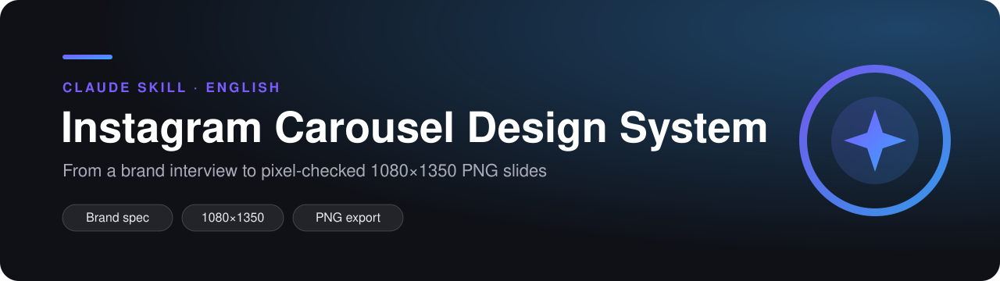

<p align="center"></p>

<p align="center">
  
  
  
</p>

<p align="center"><b>From a brand interview to pixel-checked 1080×1350 PNG slides</b></p>

---

## ✨ What it does

A Claude skill that turns a short brand interview into a persistent brand spec and layout library, then renders every new topic as pixel-checked 1080×1350 PNG carousel slides with the same rules. The brand is decided once, not re-explained on every post.

- **8-question brand interview** → `PROJECT-INSTRUCTIONS.md` (palette, type scale, slide grammar, export pipeline) + `LAYOUT-LIBRARY.md` (8–12 named compositions).
- **Two-colour rule** and headline fonts tested at the 146 px grid size.
- **Reliable export:** design at 420×525 and capture at 2.5714×, base64-embedded fonts and images, overflow measured before every screenshot.
- **Self-check:** Claude inspects every render before showing it; the user gives surgical per-slide notes.

## 🧾 Example output

```
Brand interview ──► PROJECT-INSTRUCTIONS.md + LAYOUT-LIBRARY.md
Topic ──► HTML (420×525) ──► 2.5714× capture ──► overflow check ──► exports/*.png
```

## 💬 How to use

Once installed, just ask Claude in plain language:

> "Set up my carousel system." (runs the brand interview)  
> "Make a carousel on why most product launches fail."  
> "Slide 4: tighten the headline, move the screenshot left."  

## ⚙️ Install

**Claude Code**
```bash
git clone https://github.com/erencalik/instagram-carousel-design-system-claude.git ~/.claude/skills/instagram-carousel-design-system
```
**claude.ai:** download the repo as a ZIP (Code → Download ZIP) and upload it under Settings → Capabilities → Skills.

<details>
<summary>Files</summary>

| | |
|---|---|
| `SKILL.md` | the skill itself |
| `README.md` | this page |
| `assets/banner.svg` | banner |
| `LICENSE` | MIT |

</details>

## 🔗 Works well with

| Repo | What it does |
|---|---|
| [`instagram-aciklama-carousel-metni-claude`](https://github.com/erencalik/instagram-aciklama-carousel-metni-claude) | Caption, hashtag, alt metin ve carousel metni, kontrol makbuzuyla |
| [`is-hikayesi-icerik-uretici-claude`](https://github.com/erencalik/is-hikayesi-icerik-uretici-claude) | Şirket ve kurucu hikayelerinden doğrulanmış carousel ve Reels |

All skills and how they connect: [`claude-skills-collection`](https://github.com/erencalik/claude-skills-collection)

## 📄 Credits & license

Based on the method in Michael Ly's guide [How to Build Your Own Instagram Carousel System with Claude](https://milleemd.com/guides/instagram-carousel-system); storytelling archetypes (timeline, big number, quote, sources) were added. The method's ideas belong to the original author. MIT licensed, see [LICENSE](LICENSE).
